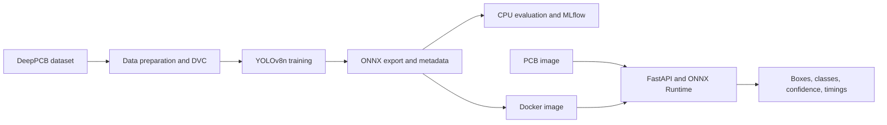

# PCB Defect Detection and MLOps

This project detects six PCB defect categories: `open`, `short`, `mousebite`, `spur`, `copper`, and `pin-hole`. I built it to practise taking a computer-vision model beyond training: versioning data, packaging a model for CPU inference, exposing it through an API, testing the service, automating releases, and monitoring the running API.

The model is based on YOLOv8n and the DeepPCB dataset. The deployment on Render was used as a validation environment rather than a public product demo.


**Stack:** Python 3.11, Ultralytics YOLOv8, ONNX Runtime, OpenCV, FastAPI, DVC, MLflow, Docker, GitHub Actions, Prometheus, Grafana, Render.

## Why I built this

I built this project to understand the work that happens after a model produces a good score in a notebook. PCB inspection was a useful case because it is a real visual quality-control problem and the DeepPCB dataset provides labelled examples for object detection.

My main goal was not to claim a production-ready factory system. It was to learn how a model can be versioned, exported, served, tested, deployed, and observed as one project. The current implementation is a first version that can be improved through new experiments, data review, and retraining.

## Results

The released ONNX model was re-evaluated on 150 test images containing 984 annotated defects. Evaluation used ONNX Runtime on CPU with an image size of 640.

| Metric | Result |
|---|---:|
| Precision (class mean) | 96.41% |
| Recall (class mean) | 94.94% |
| Macro F1 | 95.65% |
| mAP@50 | 97.82% |
| mAP@50-95 | 77.57% |

> These results come from the current image-level test split. Independence by physical PCB family has not been verified, so they describe this split rather than expected production accuracy.

## Quick start

The model package is intentionally not committed to Git. Download the versioned ONNX model and metadata from the [model-v1.0.0 GitHub Release](https://github.com/emrebyrktr/Proje1/releases/tag/model-v1.0.0) and place both files in `models/`:

```text
models/
├── pcb_defect_best.onnx
└── metadata.json
```

Build and run the API:

```bash
docker build -t pcb-defect-api:local .
docker run --rm --name pcb-api -p 127.0.0.1:8000:8000 pcb-defect-api:local
```

Open `http://127.0.0.1:8000/docs`, or send an image request:

```bash
curl -X POST http://127.0.0.1:8000/api/v1/predict -F "file=@your_image.jpg"
```

| Endpoint | Purpose |
|---|---|
| `GET /api/v1/health` | Returns model name, version, device, and classes |
| `POST /api/v1/predict` | Accepts an image in the `file` field and returns detections with timings |
| `GET /metrics` | Exposes Prometheus metrics for the local monitoring setup |
| `/docs` | Swagger UI for trying the API locally |

## How it works



Training and serving are kept separate. The training workflow uses Ultralytics, while the API image runs the exported ONNX model through ONNX Runtime on CPU and does not install PyTorch or Ultralytics. The Docker image contains only the model package and dependencies needed for inference.

## Key design decisions

- **ONNX Runtime for serving:** The trained YOLOv8 model is exported to ONNX so that the API can run on CPU without the training framework. This keeps the serving image focused, but a new model version must be exported and packaged before release.
- **Model package outside Git:** Large model files are excluded from Git. The released model package is stored as a GitHub Release asset, and CD downloads it and verifies both SHA-256 hashes before building the release image.
- **Fast feedback in CI, real-model validation in CD:** CI creates a small valid ONNX fixture so linting, tests, Docker startup, and HTTP checks remain fast. CD then validates the actual released model before any image is published.
- **Local operational monitoring:** The API exposes request, latency, HTTP status, detected-class, and confidence metrics at `/metrics`. Prometheus and Grafana are used locally to make the service behaviour visible; this is service monitoring, not live model-quality monitoring.

## Training pipeline

`prepare_data → train → export → evaluate` is defined in [`dvc.yaml`](dvc.yaml).

- Settings are kept in [`configs/config.yaml`](configs/config.yaml) and [`configs/data.yaml`](configs/data.yaml).
- DVC tracks the data and pipeline outputs through the configured remote, while Git tracks source code, configuration, and pipeline definitions.
- MLflow records the evaluation run and its model, data, and code identifiers locally.
- The current numbers come from a later CPU re-evaluation of the released ONNX package; the model weights were not retrained after the checked-in pipeline run.

## CI/CD

Every push to `main` starts CI. It runs Ruff, the pytest suite, and Docker/HTTP checks using a small test model created during the workflow. This keeps routine checks independent of the large released model file.

After CI succeeds, CD downloads `model-v1.0.0`, verifies the model package hashes, builds an image with the real model, and performs an inference smoke test. The same tested image is then tagged and pushed to Docker Hub. If the tested commit is still the latest commit on `main`, the workflow sends its image digest to Render for deployment.

Building this flow showed why a passing unit-test model is not enough on its own: the actual model package must also be downloaded, verified, loaded, and used in an inference request before release.

## Limitations and next steps

- **Possible split leakage:** The audit found near-duplicate candidates across splits: 6 validation-to-train, 10 test-to-train, and 2 validation-to-test. They require manual review. A stronger next step is to group images by PCB family before splitting and then re-evaluate.
- **Different validation and serving thresholds:** Evaluation uses a confidence threshold of `0.001` to calculate curves, whereas the API serves predictions at `0.30`. The next step is to choose the serving threshold against a defined business trade-off between missed defects and false alarms.
- **CPU latency:** The validation compute path averages about 197 ms per image on an Intel i5-9300H CPU with batch size 1. This excludes image loading, API startup, and HTTP overhead. Hardware comparison or a smaller model would be the next optimisation step.
- **Weakest class:** `short` has the lowest recall at 89.21%. Reviewing its missed samples and adding representative training data would be the first class-specific improvement.
- **Production model quality:** The current dashboard measures service behaviour only. Real model-performance monitoring would require delayed ground-truth labels from inspected boards.

## What I learned

- A trained model is not enough for a reliable demo; the model file, metadata, preprocessing, API contract, and container must stay compatible.
- CI can use a small deterministic model to be fast, but CD must still validate the real package before publishing an image.
- A successful deployment does not prove that the model is correct in production. Request metrics help detect service problems, while model-quality monitoring needs labelled feedback.
- DVC, MLflow, GitHub Releases, and Docker address different parts of reproducibility; using them together made the boundaries between data, experiments, model artifacts, and serving clearer.

<details>
<summary><b>Detailed evaluation</b></summary>

Validation used ONNX Runtime on CPU, image size 640, batch size 1, confidence `0.001`, and NMS IoU `0.70`. Precision, recall, and F1 are reported at Ultralytics' best mean-F1 operating point.

| Class | Images | Objects | Precision | Recall | F1 | AP@50 | AP@50-95 |
|---|---:|---:|---:|---:|---:|---:|---:|
| `open` | 134 | 191 | 97.87% | 96.35% | 97.10% | 97.78% | 69.67% |
| `short` | 114 | 170 | 95.59% | 89.21% | 92.29% | 95.28% | 68.98% |
| `mousebite` | 129 | 194 | 94.29% | 97.42% | 95.83% | 98.63% | 75.60% |
| `spur` | 113 | 153 | 98.17% | 95.42% | 96.78% | 97.79% | 75.45% |
| `copper` | 119 | 140 | 97.84% | 97.14% | 97.49% | 99.28% | 89.23% |
| `pin-hole` | 124 | 136 | 94.74% | 94.12% | 94.43% | 98.18% | 86.52% |


[View the raw-count confusion matrix](docs/results/confusion_matrix.png). In these matrices, columns represent ground truth and rows represent predictions. The background row contains missed objects; the background column contains unmatched detections.


The validation compute path averaged 5.22 ms preprocessing, 187.78 ms inference, and 3.72 ms postprocessing per image: 196.72 ms in total. This is not an HTTP end-to-end latency measurement.

</details>

<details>
<summary><b>Split leakage audit</b></summary>

The audit checks exact cross-split duplicates with MD5, image-similarity candidates with a 256-bit dHash, and shared label-coordinate candidates. A Hamming-distance threshold of 20 is the script default and is used as a review threshold, not proof of leakage.

```bash
python scripts/check_split_leakage.py --root data/processed
```

The checked-in review outputs are [`split_similarity_candidates.csv`](docs/results/split_similarity_candidates.csv) and [`val_test_similarity_candidates.csv`](docs/results/val_test_similarity_candidates.csv). Only exact duplicates cause the script to fail; similarity candidates require manual inspection.

</details>

<details>
<summary><b>Local monitoring</b></summary>

The API exposes Prometheus metrics at `/metrics`. In the local setup, Prometheus scrapes the API every 15 seconds and Grafana displays prediction request count, mean HTTP response time, HTTP 4xx/5xx rate, detected defects by class, and mean detection confidence.

The configuration files are [`configs/prometheus.yaml`](configs/prometheus.yaml), [`configs/grafana_dashboard.json`](configs/grafana_dashboard.json), and [`configs/grafana_alerts.yaml`](configs/grafana_alerts.yaml). API counters reset when the API restarts.

</details>

<details>
<summary><b>Development and tests</b></summary>

```bash
python -m venv .venv
python -m pip install -r requirements-dev.txt
python -m ruff check app/ ml/ scripts/ tests/
python -m pytest tests/ -v
```

The tests cover API responses and invalid inputs, model and metadata validation, per-class NMS, export and tracking behaviour, and failure cases in dataset preparation and checkpoint publication. Model training is not started by the normal test run.

For an optional local check with the actual model:

```powershell
$env:RUN_MODEL_INTEGRATION = "1"
python -m pytest tests/test_detector.py -m integration -v
Remove-Item Env:RUN_MODEL_INTEGRATION
```

</details>

<details>
<summary><b>Repository layout</b></summary>

```text
.
├── .github/workflows/   # CI and CD workflows
├── app/                 # FastAPI service, detector, inference flow, Streamlit client
├── configs/             # Training, DVC, Prometheus, Grafana configuration
├── data/                # DVC-tracked dataset; not stored in Git
├── docs/results/        # Evaluation figures and split-audit outputs
├── ml/                  # Data preparation, training, export, evaluation, tracking
├── models/              # Released ONNX model package; not stored in Git
├── scripts/             # Smoke checks, CI fixture, result and leakage utilities
├── tests/               # API, detector, package, and pipeline tests
├── Dockerfile
├── dvc.yaml
├── dvc.lock
├── requirements.txt
└── requirements-dev.txt
```

</details>

## Acknowledgements

- Dataset: [DeepPCB on Kaggle](https://www.kaggle.com/datasets/arnablaha05/deep-pcb/data)
- Libraries: [Ultralytics YOLO](https://github.com/ultralytics/ultralytics), [ONNX Runtime](https://onnxruntime.ai/), [FastAPI](https://fastapi.tiangolo.com/), [DVC](https://dvc.org/), [MLflow](https://mlflow.org/), [Prometheus](https://prometheus.io/), and [Grafana](https://grafana.com/)

## License

No license has been added yet. This repository is shared as a portfolio and learning project.
