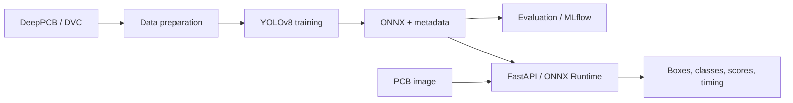
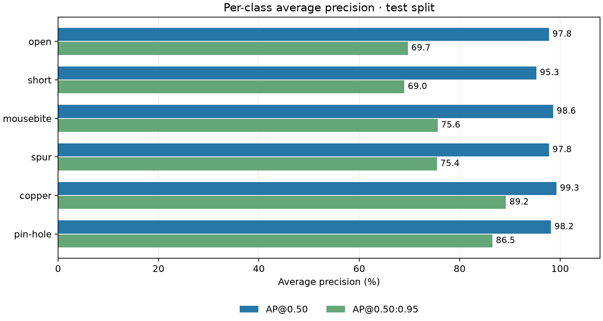
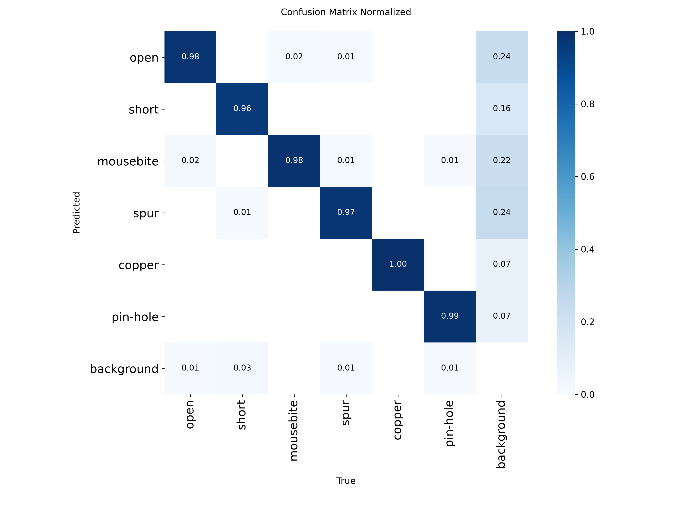
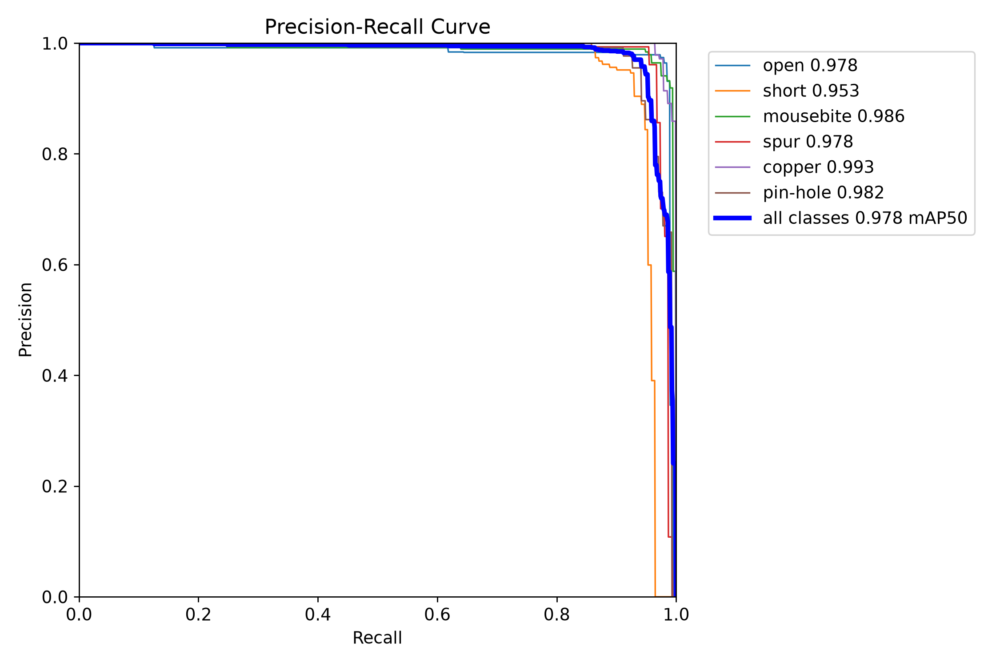
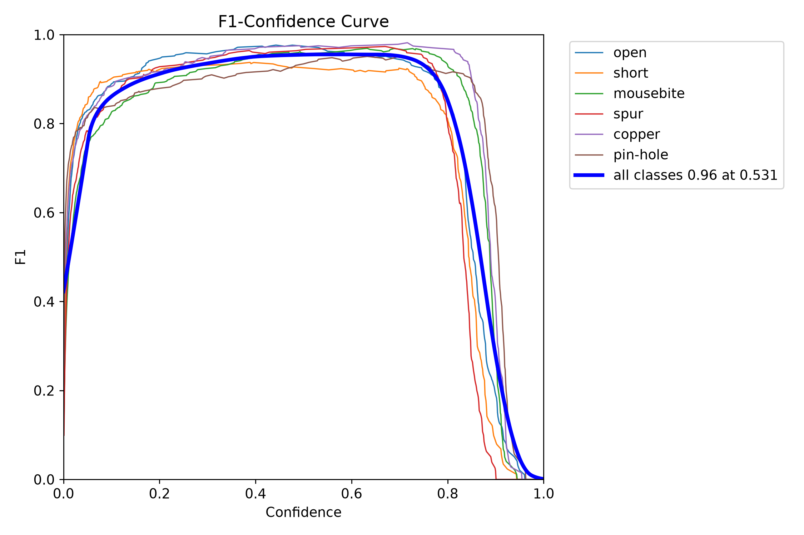
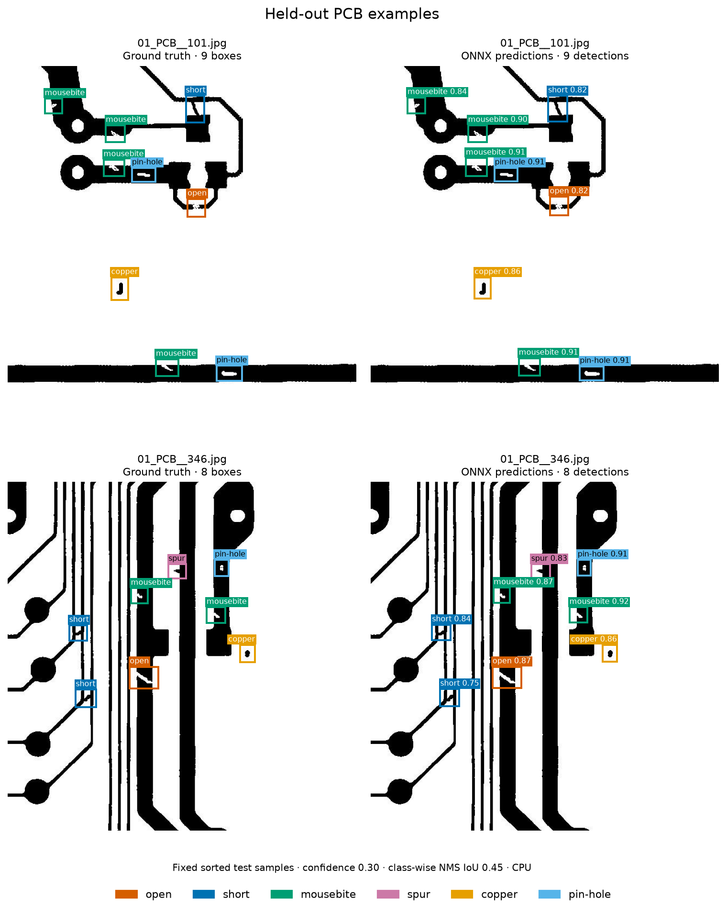

# PCB Defect Detection and MLOps
[](https://www.python.org/)
[](https://fastapi.tiangolo.com/)
[](https://onnxruntime.ai/)
[](https://www.docker.com/)
[](https://dvc.org/)
[](https://mlflow.org/)
[](https://github.com/emrebyrktr/Proje1/actions/workflows/ci.yaml)
[](https://github.com/emrebyrktr/Proje1/actions/workflows/cd.yaml)

An object detector for six types of printed circuit board defects, served through a CPU-based inference API. The repository covers dataset preparation, YOLOv8 training, evaluation, ONNX export, and automated Docker deployment.

The main goal is to take a trained model beyond a training notebook: package its inputs and outputs, test the serving code, and publish the same container image that passed inference checks.

**Stack:** Python 3.11, Ultralytics YOLOv8, ONNX Runtime, OpenCV, FastAPI, DVC, MLflow, Docker, GitHub Actions, Render.

## Dataset and task

The dataset was downloaded from [Deep PCB on Kaggle](https://www.kaggle.com/datasets/arnablaha05/deep-pcb/data). The model predicts bounding boxes, class labels, and confidence scores for six defect classes:

| Class | Defect |
|---|---|
| `open` | Broken circuit trace |
| `short` | Unwanted connection between traces |
| `mousebite` | Notch along a trace edge |
| `spur` | Protrusion along a trace edge |
| `copper` | Spurious copper |
| `pin-hole` | Hole in a copper region |

Data and model files are stored through DVC and Google Drive. Git tracks the source code, configuration, pipeline definitions, and DVC references.

## Architecture



Training and serving have separate dependencies. The API image runs ONNX Runtime on CPU without installing PyTorch or Ultralytics. Evaluation results and model, data, and code identifiers are recorded in a local MLflow store.

### Implementation decisions

- **Data preparation:** Image/label pairs and bounding boxes are validated. New outputs are staged before replacing existing data, with rollback on failure.
- **Checkpoint selection:** Training uses the best checkpoint produced by the trainer. A temporary copy and atomic replacement protect the existing checkpoint during publication.
- **Model loading:** The API loads the ONNX file and metadata at startup. Invalid or missing files stop startup. A model hash is checked when the metadata provides one.
- **Inference:** Preprocessing, CPU inference, and per-class OpenCV NMS form the detection pipeline. Inference runs in a thread pool to keep it out of the async request loop.
- **Input limits:** Uploads default to a 10 MiB limit, and decoded images are limited to 25 million pixels. Invalid images receive an error response.
- **Deployment:** The container that passes the inference smoke check is pushed to Docker Hub without rebuilding. Render receives a deployment request using that image's digest.

## Repository layout

```text
.
├── .github/workflows/   # ci.yaml, cd.yaml
├── app/
│   ├── api/             # FastAPI endpoints and response schemas
│   ├── core/            # ONNX detector and configuration
│   ├── services/        # model loading and prediction flow
│   ├── ui/              # Streamlit client (app.py)
│   └── utils/           # config loading and shared helpers
├── configs/             # config.yaml, data.yaml
├── docs/results/         # Evaluation figures and source summary
├── data/                # DVC-tracked dataset (not stored in Git)
├── ml/                  # prepare_data, train, export_package, evaluate, tracker
├── models/              # pcb_defect_best.onnx, metadata.json (not stored in Git)
├── scripts/             # smoke_api.py, check_split_leakage.py
├── tests/               # pytest suite and locustfile.py
├── Dockerfile
├── dvc.yaml
├── dvc.lock
├── pyproject.toml
├── requirements.txt
└── requirements-dev.txt
```

## Code map

| Location | Responsibility |
|---|---|
| [ml/prepare_data.py](ml/prepare_data.py) | Label conversion, validation, and dataset preparation |
| [ml/train.py](ml/train.py) | Training and best-checkpoint publication |
| [ml/export_package.py](ml/export_package.py) | ONNX export and metadata generation |
| [ml/evaluate.py](ml/evaluate.py), [ml/tracker.py](ml/tracker.py) | Evaluation reports and MLflow records |
| [app/core/onnx_detector.py](app/core/onnx_detector.py) | Preprocessing, inference, and NMS |
| [app/utils/config_loader.py](app/utils/config_loader.py), [app/core/config.py](app/core/config.py) | Shared YAML loading and environment overrides |
| [app/services/](app/services/) | Model loading and prediction flow |
| [app/api/](app/api/) | FastAPI endpoints and response schemas |
| [app/ui/app.py](app/ui/app.py) | Local Streamlit client for the API |
| [scripts/build_readme_results.py](scripts/build_readme_results.py) | Figures and example predictions from the evaluation report |
| [tests/](tests/) | Service, model-package, and pipeline regression tests |
| [.github/workflows/](.github/workflows/) | CI checks and automated releases |

## Results and verification

The released ONNX model was re-evaluated on **150 test images with 984 annotated defects** on 9 November 2026. The current [evaluation report](reports/metrics.json) records the model hash, validation settings, and local MLflow run. [Figure sources and sample predictions](docs/results/summary.json) include a content fingerprint of the test images and labels.

| Metric | Current test result |
|---|---:|
| Precision (class mean) | 96.41% |
| Recall (class mean) | 94.94% |
| Macro F1 | 95.65% |
| mAP@50 | 97.82% |
| mAP@50-95 | 77.57% |

Validation used ONNX Runtime on CPU, image size 640, batch size 1, confidence floor 0.001, and NMS IoU 0.70. Summary precision, recall, and F1 use Ultralytics' maximum mean-F1 confidence point; macro F1 is the mean of class F1 scores. The release metadata retains its earlier measurements. The table above comes from this new run.

### Class results

`Images` counts test images containing the class; these counts overlap across classes. `Objects` counts annotated boxes. All score columns are percentages.

| Class | Images | Objects | Precision | Recall | F1 | AP@50 | AP@50-95 |
|---|---:|---:|---:|---:|---:|---:|---:|
| open | 134 | 191 | 97.87% | 96.35% | 97.10% | 97.78% | 69.67% |
| short | 114 | 170 | 95.59% | 89.21% | 92.29% | 95.28% | 68.98% |
| mousebite | 129 | 194 | 94.29% | 97.42% | 95.83% | 98.63% | 75.60% |
| spur | 113 | 153 | 98.17% | 95.42% | 96.78% | 97.79% | 75.45% |
| copper | 119 | 140 | 97.84% | 97.14% | 97.49% | 99.28% | 89.23% |
| pin-hole | 124 | 136 | 94.74% | 94.12% | 94.43% | 98.18% | 86.52% |



`short` has the lowest recall (89.21%). `short` and `open` also have the lowest AP@50-95, making them useful starting points for reviewing missed detections and box localization.

### Confusion matrix



[Raw counts](docs/results/confusion_matrix.png). Columns represent ground truth and rows represent predictions. The background row contains missed objects; the background column contains unmatched detections. This matrix uses validation confidence 0.001 and ground-truth matching IoU 0.45; its operating point differs from the summary P/R/F1 values.

<details>
<summary>Precision-recall and F1-confidence curves</summary>





</details>

### Example detections



Left: annotations. Right: actual predictions from the API's `ONNXDetector`, using confidence 0.30 and NMS IoU 0.45 on CPU. Samples are fixed sorted positions 0 and 75 (`01_PCB__101.jpg` and `01_PCB__346.jpg`), selected before reviewing predictions. These serving thresholds differ from the validation settings above.

### Timing and split checks

Local validation averaged **5.22 ms preprocessing, 187.78 ms inference, and 3.72 ms postprocessing per image** (196.72 ms combined) on an Intel Core i5-9300H CPU. This measures the validation compute path with batch size 1; image loading, startup, and HTTP overhead are outside this timing.

The split audit found no byte-identical files across splits. At the default dHash threshold of 20/256 bits, it flagged [6 validation-to-train and 10 test-to-train candidates](docs/results/split_similarity_candidates.csv), plus [2 validation-to-test candidates](docs/results/val_test_similarity_candidates.csv). These require manual review. Independence by physical PCB family has not been established, so the scores describe the current image split.

**Deployment check:** On 9 November 2026, an automatic release reached `Live` on Render. A real PCB request returned `success: true`, seven detections, and about five seconds total processing time. That is a separate cloud request measurement.

To repeat the model evaluation and rebuild the figures:

```powershell
python -m ml.evaluate --model models/pcb_defect_best.onnx --device cpu --tracking-uri sqlite:///mlflow.db
python -m scripts.build_readme_results
```

Metric definitions and validation behavior: [Ultralytics validation](https://docs.ultralytics.com/modes/val/) and [performance metrics](https://docs.ultralytics.com/guides/yolo-performance-metrics/).

## Local setup

Run commands from the repository root. Both the API and the Docker build require:

```text
models/pcb_defect_best.onnx
models/metadata.json
```

Download the two files from the [model-v1.0.0 release](https://github.com/emrebyrktr/Proje1/releases/tag/model-v1.0.0) into `models/`. Developers with access to the configured DVC remote can also use `dvc pull`. Model files and data are excluded from Git; Google Drive credentials belong in the local `.dvc/config.local` file.

### Docker

```powershell
docker build -t pcb-defect-api:local .
docker run --rm --name pcb-api -p 127.0.0.1:8000:8000 pcb-defect-api:local
```

The Dockerfile uses `python:3.11-slim`, an unprivileged application user, and a health check.

### Python

This setup includes the training, UI, and test tools. Docker uses the API-only `requirements.txt`; development uses `requirements-dev.txt` with the OpenCV package required by Ultralytics.

```powershell
python -m venv .venv
.\.venv\Scripts\Activate.ps1
python -m pip install -r requirements-dev.txt
python -m uvicorn app.api.main:app --host 127.0.0.1 --port 8000
```

| Endpoint | Purpose |
|---|---|
| `GET /api/v1/health` | Model name, version, device, and classes |
| `POST /api/v1/predict` | Image upload in the `file` field; detections and timing |
| `/docs` | Local Swagger documentation |

The `/health` and `/predict` aliases are also available. The local server address is `http://127.0.0.1:8000`.

## Development and tests

With the development environment activated:

```powershell
python -m ruff check app/ ml/ scripts/ tests/
python -m pytest tests/ -v
```

The test suite covers API responses and invalid inputs, model/metadata validation, per-class NMS, export and tracking behavior, dataset preparation failures, and interrupted checkpoint publication. The normal test run does not start model training.

Integration checks with the actual model are opt-in:

```powershell
$env:RUN_MODEL_INTEGRATION = "1"
python -m pytest tests/test_detector.py -m integration -v
Remove-Item Env:RUN_MODEL_INTEGRATION
```

To check health and inference against a running local API:

```powershell
python scripts/smoke_api.py --expected-model DeepPCB-YOLOv8
```

The Streamlit client can be started in a separate terminal with `streamlit run app/ui/app.py`. An optional Locust scenario is available in `tests/locustfile.py`.

To inspect duplicate files and similarity candidates across dataset splits:

```powershell
python scripts/check_split_leakage.py --root data/processed
```

Outputs are written to `reports/split_leakage/`. `near_duplicates.csv` compares validation/test images with training images; `val_test_near_duplicates.csv` compares validation with test when both are present. Similarity and matching label coordinates are review candidates. Only byte-identical files across splits cause exit code `1`; missing or empty splits return `2`.

## Training pipeline

[dvc.yaml](dvc.yaml) defines:

```text
prepare_data → train → export → evaluate
```

With training data and development dependencies in place, `dvc repro` runs changed pipeline stages and may start training. Model and training settings are in [configs/config.yaml](configs/config.yaml); dataset paths and class names are in [configs/data.yaml](configs/data.yaml). The default training device is `0`, while serving uses `cpu`.

The checked-in `dvc.lock` describes an earlier full pipeline run. Model weights have not been retrained; the current CPU evaluation is recorded separately in `reports/metrics.json`. Training and model promotion are manually initiated; evaluation results are recorded in MLflow.

## CI/CD

```text
Push to main
  → CI: Ruff, pytest, and Docker/HTTP checks with a test model
  → CD: download the real model package and verify its hashes
  → build the container and check inference with the real model
  → push the tested image to Docker Hub
  → request a Render deployment by digest for the current main commit
```

- [ci.yaml](.github/workflows/ci.yaml) runs on pushes and pull requests to `main`. Its small ONNX fixture checks the serving code.
- [cd.yaml](.github/workflows/cd.yaml) runs after successful CI for a `main` push from the same repository. It downloads the actual model from a GitHub release; the CI fixture is not published.
- Each run creates an image tag containing the tested commit SHA and run identifiers. The current release candidate also receives the `demo` tag. Render is given the image digest.
- Release runs are queued. If the tested commit is no longer the tip of `main`, the deployment request is skipped.
- Failed model verification or inference checks stop publication. A successful hook request and a `Live` deployment are checked separately.

Required GitHub Actions repository secrets: `DOCKERHUB_USERNAME`, `DOCKERHUB_TOKEN`, and `RENDER_DEPLOY_HOOK`. Secret values are kept out of workflow files.

A new model release requires updating its release tag and both package hashes in the CD workflow. Model versions and application/image versions are tracked separately.

## Local monitoring

The API logs request methods, paths, HTTP statuses and durations, and exposes Prometheus metrics at `/metrics`.

- [Prometheus configuration](configs/prometheus.yaml): collects metrics every 15 seconds.
- [Grafana dashboard](configs/grafana_dashboard.json): shows prediction request count, mean HTTP response time in milliseconds, HTTP 4xx/5xx percentage, and detected defect counts by class.

The panels show cumulative measurements since API startup.

When using Docker Desktop, start the host API with:

```powershell
python -m uvicorn app.api.main:app --host 0.0.0.0 --port 8000
```

Prometheus and Grafana share the `pcb-monitoring` Docker network. Grafana connects to `http://pcb-prometheus:9090`. When importing the dashboard into another Grafana instance, reassign its Prometheus data source.