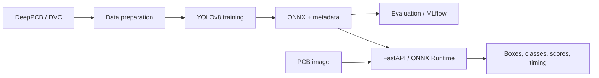

# PCB Defect Detection and MLOps

[](https://github.com/emrebyrktr/Proje1/actions/workflows/ci.yml)
[](https://github.com/emrebyrktr/Proje1/actions/workflows/cd.yml)

An object detector for six types of printed circuit board defects, served through a CPU-based inference API. The repository covers dataset preparation, YOLOv8 training, evaluation, ONNX export, and automated Docker deployment.

The main goal is to take a trained model beyond a training notebook: package its inputs and outputs, test the serving code, and publish the same container image that passed inference checks.

**Stack:** Python 3.11, Ultralytics YOLOv8, ONNX Runtime, OpenCV, FastAPI, DVC, MLflow, Docker, GitHub Actions, Render.

## Dataset and task

The model uses the [DeepPCB dataset](https://github.com/tangsanli5201/DeepPCB) and predicts bounding boxes, class labels, and confidence scores for six defect classes:

| Class | Defect |
|---|---|
| `open` | Broken circuit trace |
| `short` | Unwanted connection between traces |
| `mousebite` | Notch along a trace edge |
| `spur` | Protrusion along a trace edge |
| `copper` | Spurious copper |
| `pin-hole` | Hole in a copper region |

Data and model files are stored through DVC and Google Drive. Git tracks the source code, configuration, pipeline definitions, and DVC references.

## Architecture



Training and serving have separate dependencies. The API image runs ONNX Runtime on CPU without installing PyTorch or Ultralytics. Evaluation results and model, data, and code identifiers are recorded in a local MLflow store.

### Implementation decisions

- **Data preparation:** Image/label pairs and bounding boxes are validated. New outputs are staged before replacing existing data, with rollback on failure.
- **Checkpoint selection:** Training uses the best checkpoint produced by the trainer. A temporary copy and atomic replacement protect the existing checkpoint during publication.
- **Model loading:** The API loads the ONNX file and metadata at startup. Invalid or missing files stop startup. A model hash is checked when the metadata provides one.
- **Inference:** Preprocessing, CPU inference, and per-class OpenCV NMS form the detection pipeline. Inference runs in a thread pool to keep it out of the async request loop.
- **Input limits:** Uploads default to a 10 MiB limit, and decoded images are limited to 25 million pixels. Invalid images receive an error response.
- **Deployment:** The container that passes the inference smoke check is pushed to Docker Hub without rebuilding. Render receives a deployment request using that image's digest.

## Code map

| Location | Responsibility |
|---|---|
| [ml/prepare_data.py](ml/prepare_data.py) | Label conversion, validation, and dataset preparation |
| [ml/train.py](ml/train.py) | Training and best-checkpoint publication |
| [ml/export_package.py](ml/export_package.py) | ONNX export and metadata generation |
| [ml/evaluate.py](ml/evaluate.py), [ml/tracker.py](ml/tracker.py) | Evaluation reports and MLflow records |
| [app/core/onnx_detector.py](app/core/onnx_detector.py) | Preprocessing, inference, and NMS |
| [app/utils/config_loader.py](app/utils/config_loader.py), [app/core/config.py](app/core/config.py) | Shared YAML loading and environment overrides |
| [app/services/](app/services/) | Model loading and prediction flow |
| [app/api/](app/api/) | FastAPI endpoints and response schemas |
| [app/ui/app.py](app/ui/app.py) | Local Streamlit client for the API |
| [tests/](tests/) | Service, model-package, and pipeline regression tests |
| [.github/workflows/](.github/workflows/) | CI checks and automated releases |

## Results and verification

The released `model-v1.0.0` package contains these test metrics in `metadata.json`:

| Metric | Value |
|---|---:|
| Precision | 97.36% |
| Recall | 95.24% |
| mAP@50 | 98.06% |
| mAP@50-95 | 76.81% |

These are recorded results from the existing model package. They were not recalculated after the latest source changes. The evaluation script writes new results to `reports/metrics.json` and MLflow.

**Deployment check:** On 9 November 2026, the automated release reached `Live` on Render. A request using `01_PCB__98.jpg` returned `success: true`, seven detections, and approximately five seconds of total processing time. This was a single-request check of the deployed service; throughput and accuracy require separate measurements.

## Local setup

Run commands from the repository root. Both the API and the Docker build require:

```text
models/pcb_defect_best.onnx
models/metadata.json
```

Download the two files from the [model-v1.0.0 release](https://github.com/emrebyrktr/Proje1/releases/tag/model-v1.0.0) into `models/`. Developers with access to the configured DVC remote can also use `dvc pull`. Model files and data are excluded from Git; Google Drive credentials belong in the local `.dvc/config.local` file.

### Docker

```powershell
docker build -t pcb-defect-api:local .
docker run --rm --name pcb-api -p 127.0.0.1:8000:8000 pcb-defect-api:local
```

The Dockerfile uses `python:3.11-slim`, an unprivileged application user, and a health check.

### Python

```powershell
python -m venv .venv
.\.venv\Scripts\Activate.ps1
python -m pip install -r requirements.txt
python -m uvicorn app.api.main:app --host 127.0.0.1 --port 8000
```

| Endpoint | Purpose |
|---|---|
| `GET /api/v1/health` | Model name, version, device, and classes |
| `POST /api/v1/predict` | Image upload in the `file` field; detections and timing |
| `/docs` | Local Swagger documentation |

The `/health` and `/predict` aliases are also available. The local server address is `http://127.0.0.1:8000`.

## Development and tests

```powershell
python -m pip install -r requirements-dev.txt
python -m ruff check app/ ml/ scripts/ tests/
python -m pytest tests/ -v
```

The test suite covers API responses and invalid inputs, model/metadata validation, per-class NMS, export and tracking behavior, dataset preparation failures, and interrupted checkpoint publication. The normal test run does not start model training.

Integration checks with the actual model are opt-in:

```powershell
$env:RUN_MODEL_INTEGRATION = "1"
python -m pytest tests/test_detector.py -m integration -v
Remove-Item Env:RUN_MODEL_INTEGRATION
```

To check health and inference against a running local API:

```powershell
python scripts/smoke_api.py --expected-model DeepPCB-YOLOv8
```

The Streamlit client can be started in a separate terminal with `streamlit run app/ui/app.py`. An optional Locust scenario is available in `tests/locustfile.py`.

## Training pipeline

[dvc.yaml](dvc.yaml) defines:

```text
prepare_data → train → export → evaluate
```

With training data and development dependencies in place, `dvc repro` runs changed pipeline stages and may start training. Model and training settings are in [configs/config.yaml](configs/config.yaml); dataset paths and class names are in [configs/data.yaml](configs/data.yaml). The default training device is `0`, while serving uses `cpu`.

The checked-in `dvc.lock` describes an earlier pipeline run. The full training and evaluation pipeline has not been rerun after the latest source changes. Training and model promotion are manually initiated; evaluation results are recorded in MLflow.

## CI/CD

```text
Push to main
  → CI: Ruff, pytest, and Docker/HTTP checks with a test model
  → CD: download the real model package and verify its hashes
  → build the container and check inference with the real model
  → push the tested image to Docker Hub
  → request a Render deployment by digest for the current main commit
```

- [ci.yml](.github/workflows/ci.yml) runs on pushes and pull requests to `main`. Its small ONNX fixture checks the serving code.
- [cd.yml](.github/workflows/cd.yml) runs after successful CI for a `main` push from the same repository. It downloads the actual model from a GitHub release; the CI fixture is not published.
- Each run creates an image tag containing the tested commit SHA and run identifiers. The current release candidate also receives the `demo` tag. Render is given the image digest.
- Release runs are queued. If the tested commit is no longer the tip of `main`, the deployment request is skipped.
- Failed model verification or inference checks stop publication. A successful hook request and a `Live` deployment are checked separately.

Required GitHub Actions repository secrets: `DOCKERHUB_USERNAME`, `DOCKERHUB_TOKEN`, and `RENDER_DEPLOY_HOOK`. Secret values are kept out of workflow files.

A new model release requires updating its release tag and both package hashes in the CD workflow. Model versions and application/image versions are tracked separately.
